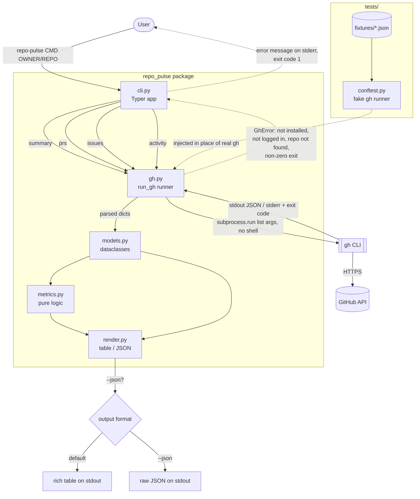
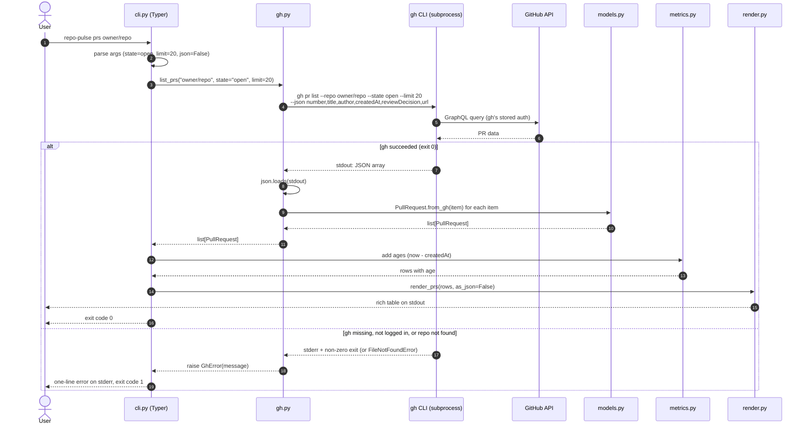

# repo-pulse architecture

repo-pulse is a Python command-line tool, built with Typer, that reports on GitHub repositories. All data comes from the `gh` CLI. No GitHub API token is handled directly.

## Modules

| Module | Responsibility |
|---|---|
| `cli.py` | Typer app. Parses arguments, wires the pieces together, sets exit codes. |
| `gh.py` | The only module that runs `gh`. Builds argument lists, runs the subprocess, parses JSON, and turns failures into `GhError`. |
| `models.py` | Dataclasses: `RepoSummary`, `PullRequest`, `Issue`, `Activity`. |
| `metrics.py` | Pure functions: ages, counts, activity rollups. No I/O. |
| `render.py` | Turns models into a `rich` table or JSON. |

## Flowchart

## Sequence: `repo-pulse prs owner/repo`

