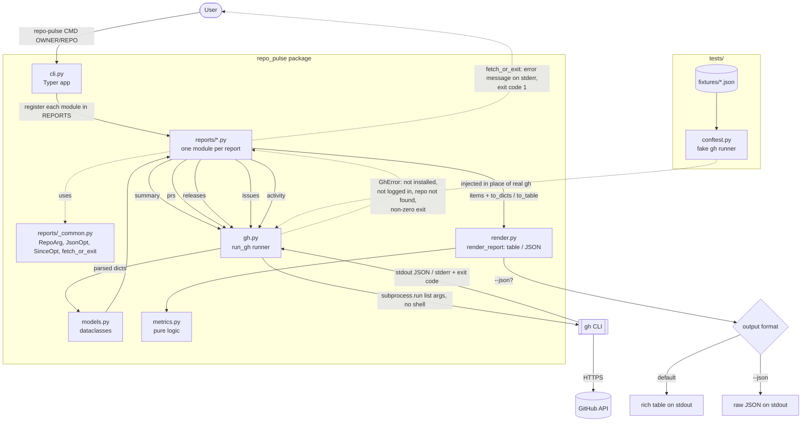
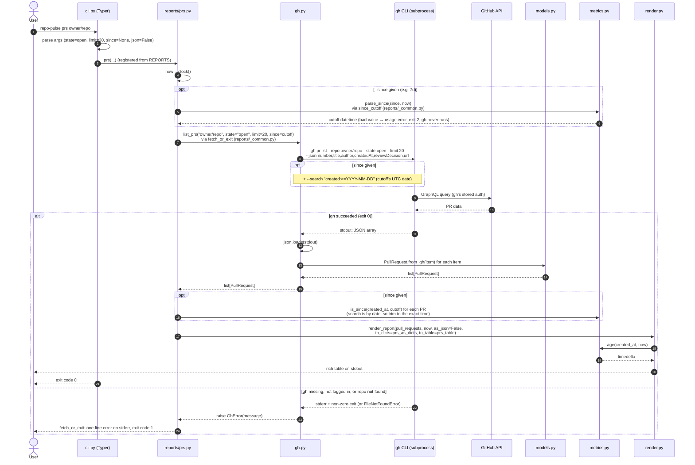
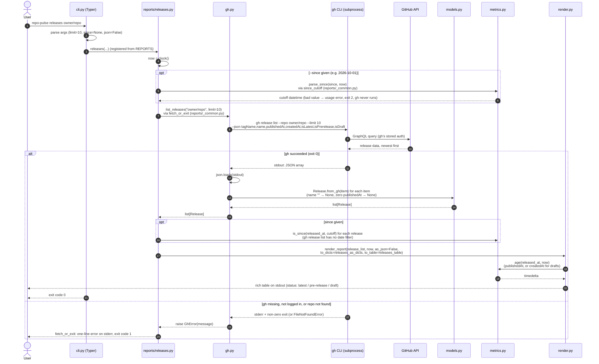

# repo-pulse architecture

repo-pulse is a Python command-line tool, built with Typer, that reports on GitHub repositories. All data comes from the `gh` CLI. No GitHub API token is handled directly.

## Modules

| Module | Responsibility |
|---|---|
| `cli.py` | Typer app: `--version`, the subcommand callback, and a loop that registers every module in `REPORTS`. No report code. |
| `reports/<name>.py` | One module per report (`prs.py`, `releases.py`). Each has a `register(app, *, runner, clock)` that defines its command, plus that report's JSON rows and table columns. |
| `reports/__init__.py` | `REPORTS = [prs, releases]`: the list of report modules, in `--help` order. |
| `reports/_common.py` | Shared command pieces: `RepoArg`, `JsonOpt`, `SinceOpt`, `since_cutoff` (bad `--since` → usage error, exit 2), `fetch_or_exit` (the `GhError` → `error:` / exit 1 contract), `repo_title`. |
| `gh.py` | The only module that runs `gh`. Builds argument lists, runs the subprocess, parses JSON, and turns failures into `GhError`. |
| `models.py` | Dataclasses: `RepoSummary`, `PullRequest`, `Release`, `Issue`, `Activity`. |
| `metrics.py` | Pure functions: ages, `--since` parsing (`parse_since`, `is_since`), counts, activity rollups. No I/O. |
| `render.py` | Shared output for every report: `render_report` (JSON / "No … found" / `rich` table), `age_fields`, `age_cell`. |

## Flowchart

## Sequence: `repo-pulse prs owner/repo`

## Sequence: `repo-pulse releases owner/repo`

